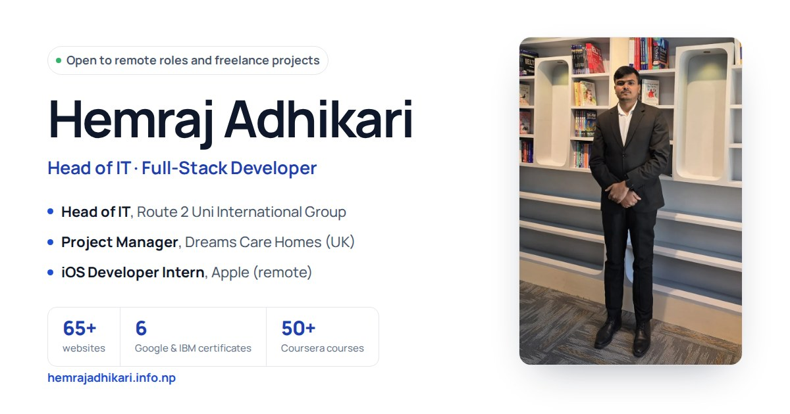

# Hemraj Adhikari · Portfolio

Personal website of **Hemraj Adhikari**, full-stack developer and Head of IT in Kathmandu, Nepal.

I build CRM platforms and internal tools with Next.js, NestJS and PostgreSQL, and run the AWS infrastructure under them. Right now I lead the CRM rebuild at Route2Uni International Group and manage a CRM and staff-compliance portal for Dreams Care Homes in the UK.

**Live site:** [hemrajadhikari.info.np](https://hemrajadhikari.info.np) · **LinkedIn:** [in/hemrajadhikariy](https://www.linkedin.com/in/hemrajadhikariy/) · **CV:** [PDF](https://hemrajadhikari.info.np/CV-Hemraj%20Adhikari.pdf)



## Pages

| Page | What is on it |
|---|---|
| [`index.html`](https://hemrajadhikari.info.np/) | Home: introduction, services, selected projects, career timeline, certificates, education, contact |
| [`about.html`](https://hemrajadhikari.info.np/about.html) | Background, how I work, photos and a short clip from a talk |
| [`services.html`](https://hemrajadhikari.info.np/services.html) | CRM and internal tools, web apps, cloud and DevOps, IT setup, security review, reporting |
| [`projects.html`](https://hemrajadhikari.info.np/projects.html) | 14 projects with a details panel for each one |
| [`experience.html`](https://hemrajadhikari.info.np/experience.html) | Roles since 2023 and the skills I use at work |
| [`education.html`](https://hemrajadhikari.info.np/education.html) | BSc CSIT, BIT and +2 Computer Science |
| [`credentials.html`](https://hemrajadhikari.info.np/credentials.html) | 7 professional certificates and 37 course certificates, each with a Coursera verification link |
| [`contact.html`](https://hemrajadhikari.info.np/contact.html) | Contact form, email, WhatsApp and FAQ |
| [`resume.html`](https://hemrajadhikari.info.np/resume.html) | One-page resume, same content as the PDF CV |
| `case-*.html` | Case studies: Route2Uni CRM, Dreams Care Homes CRM, Hajiri HR |
| `blog.html`, `blog-*.html` | Articles on CRMs, cloud and starting in IT in Nepal ([RSS](https://hemrajadhikari.info.np/feed.xml)) |
| `thanks.html` | Shown after the contact form sends (not indexed) |

## Selected projects

- **Route2Uni CRM**: student pipeline from enquiry to visa for 50+ staff and 30+ partners, now being rebuilt on Next.js, NestJS, PostgreSQL, Prisma, Redis and AWS.
- **Dreams Care Homes CRM** (UK): right-to-work, visa sponsorship and DBS expiry tracking with an audit log. I lead the roadmap and the build.
- **Hajiri HR and Attendance**: attendance, leave and approvals for Route2Uni, with Bikram Sambat and AD dates.
- **Kaam Khoj**: free app that helps daily-wage workers find nearby jobs and call employers directly.
- **Slotly**: booking app and web app any business can use.
- **Partner Bulk Messaging**: WhatsApp and email outreach to partner agents for the B2B team.

## How the site is built

Plain HTML, CSS and JavaScript, served by GitHub Pages straight from this repository (custom domain in `CNAME`). Fonts are self-hosted, so the site makes no requests to Google. There is no tracking unless you turn on GoatCounter in `assets/js/config.js`.

```
index.html, about.html, ...   one file per page
assets/js/config.js           site settings: analytics, booking link, testimonials (edit this)
assets/css/portfolio.css      styles for the main pages (light and dark mode)
assets/js/portfolio.js        project and certificate data, menu, search, project panel,
                              certificate viewer, contact form, GitHub list, testimonials
assets/css/site.css           styles for the blog
assets/js/site.js             blog menu and table of contents
*.min.css, *.min.js           generated by `npm run build`, never edit by hand
assets/fonts/                 Inter, JetBrains Mono, Playfair Display, Cinzel, Manrope (OFL)
assets/img/                   photos (me/), certificates (courses/), icons, social image
assets/data/github.json       recent public repos, refreshed daily by GitHub Actions
CV-Hemraj Adhikari.pdf        the CV every "Download CV" button links to
sitemap.xml, feed.xml         generated by `npm run build`
tools/                        build and check scripts (Node)
.github/workflows/            Quality (checks on every push) and Maintain (build + daily refresh)
```

Each page has its own title, description, Open Graph tags and schema.org data (Person, WebPage, Article, BreadcrumbList) so it shows up properly in Google and when shared on LinkedIn or WhatsApp.

## Settings (`assets/js/config.js`)

Everything here is off until you fill it in:

- **`goatcounter`**: privacy-friendly visitor stats. Create a free site at goatcounter.com and put its code here, e.g. `'hemraj'`.
- **`bookingUrl`**: a Cal.com or Calendly link. Adds a "Book a 15-minute call" button on the home and contact pages.
- **`testimonials`**: real quotes only, with permission (LinkedIn recommendations work well). The "Kind words" section on the home page appears as soon as there is one.

## Updating

- **Text:** edit the page's `.html` file.
- **Projects:** edit the `PROJECTS` list near the top of `assets/js/portfolio.js`. Extra details for the project panel live in `DETAIL`. Add `case: 'case-name.html'` to show a "Case study" link on the card.
- **Certificates:** professional certificates are in `CERTS`, course certificates in `COURSES` (title, programme, date, Coursera verify code). Put the image in `assets/img/courses/` named after the verify code in lowercase, as `code.webp` and `code-sm.webp`.
- **New blog post:** copy an existing `blog-*.html`, change the text and its JSON-LD (`headline`, `description`, `datePublished`), and add a card to `blog.html`. The RSS feed and sitemap pick it up on the next build.
- **CV:** replace `CV-Hemraj Adhikari.pdf` with a new file of the same name.

## Build and checks

Needs Node 22. Run `npm install` once.

| Command | What it does |
|---|---|
| `npm run build` | Minifies CSS/JS, updates the `?v=` cache-busting hashes, writes `sitemap.xml`, `feed.xml` and the CSP hashes in `.htaccess` |
| `npm run check` | Broken links and anchors, titles, descriptions, canonical and Open Graph tags, alt text, JSON-LD, sitemap coverage, stale `.min` files |
| `npm run a11y` | axe accessibility test of every page in light and dark mode, including colour contrast (needs `npx playwright install chromium` once) |
| `npm run css:unused` | Lists CSS selectors that no page uses |
| `npm run github` | Refreshes `assets/data/github.json` |
| `npm run serve` | Local preview at http://localhost:8080 |

You don't have to run the build yourself: after every push to `main`, the **Maintain** workflow builds, refreshes the GitHub list and commits the result. It also runs every morning. The **Quality** workflow runs the checks, HTML validation, the accessibility test and Lighthouse on every push and pull request.

## Contact

hemrajhadhikari@gmail.com · +977 986-5802093 · Kathmandu, Nepal

© 2026 Hemraj Adhikari
